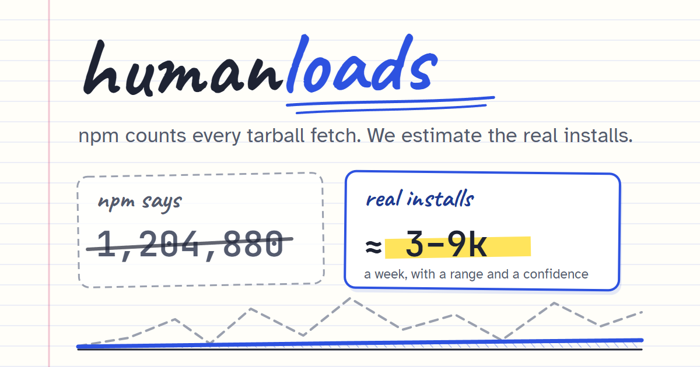

<div align="center">

# humanloads

**npm download stats, and how many are real installs.**

[](https://humanloads.dev)
[](https://github.com/ZenyaDAR/humanloads/actions/workflows/deploy.yml)
[](LICENSE)
[](#privacy)
[](#privacy)

[](https://humanloads.dev)

</div>

## The problem

npm's download counter counts every tarball fetch, not every person. Registry mirrors, security scanners,
CI pipelines and crawlers all add to it. A brand-new version gets 100–150 "downloads" within days even if
nobody uses it, and crawlers fetch every old version a few times a week, forever.

For a small package that noise can be 90% of the number, so "1,200 weekly downloads" might mean a thriving
project, or two users and a lot of robots. For a big package it is a rounding error, and the count is mostly CI,
builds and dependency installs that no public data can separate from people.

## What humanloads does

Type a package name at **[humanloads.dev](https://humanloads.dev)** and get:

- **Real installs per week**, next to npm's raw count: what remains after removing publish spikes and the
  crawler floor, as a range with a confidence level (high, medium or low).
- **Where the downloads went**: how much went to mirrors and scanners, how much to crawlers, how much is left.
- **Which versions are in use**: the share on the latest major version, and a per-version breakdown with the flat
  "crawler floor" every version gets.
- **Independent evidence of use** that is much harder to fake: dependent packages and repositories,
  jsDelivr CDN hits, GitHub activity.
- **Side-by-side comparison** of 2–3 packages: [react vs vue](https://humanloads.dev/compare/react,vue).
- **A daily list** of settled packages with the most noise in their count.

**This is not a count of people.** Real installs still include CI runs, Docker builds and installs as a
dependency of other packages. Nobody can tell those apart from people using public data, npm included.

## How the estimate works

1. **Cut the publish spikes.** Every new version gets a burst from mirrors in its first days. Each spike is
   compared with the same weekday in the weeks around it and cut back to that level.
2. **Subtract the crawler floor.** Robots download *every* published version at about the same weekly rate.
   That floor is measured on old versions and subtracted from all of them.
3. **Report a range, not a number.** What is left becomes a weekly range, widened by counting noise, and its top
   keeps any spike that was cut, since real users can arrive on release day. High confidence needs independent
   evidence of use, because direct tarball requests pass both filters.

A canary package that nobody uses is published regularly to measure the bot noise directly. The numbers have
not been checked against packages with a known audience yet. The full method, thresholds and known limits are on
the **[methodology page](https://humanloads.dev/docs/methodology)**.

## Badge for your README

Show real installs next to your download count:

[](https://humanloads.dev/zod)

```md
[](https://humanloads.dev/<name>)
```

For a scoped package, `@scope/name` becomes `scope__name` in the badge URL. Badges are rebuilt daily for
packages listed in [`data/tracked.json`](data/tracked.json): add yours with a one-line pull request.

## Open data

The daily numbers are published as JSON, free to use:

- [`/data/summary.json`](https://humanloads.dev/data/summary.json): the catalog, part of which is refreshed each
  night (npm weekly count, real installs, range, noise share, confidence, date of that row).
- [`/data/featured.json`](https://humanloads.dev/data/featured.json): the homepage list.
- [`/data/insights.json`](https://humanloads.dev/data/insights.json): the most downloaded deprecated packages, dependency trails and median growth across the catalog.
- [`/llms.txt`](https://humanloads.dev/llms.txt): a summary of the site for AI assistants.

## Privacy

humanloads is a static site with no backend, no accounts and no cookies. Your browser talks to public APIs
(npm, npms.io for search suggestions, ecosyste.ms, jsDelivr, GitHub) directly; fonts come from Google Fonts. Page views are counted with
[Cloudflare Web Analytics](https://www.cloudflare.com/web-analytics/), which uses no cookies and does not
fingerprint or track visitors across sites.

## Built with

TypeScript and [Vite](https://vite.dev), [Rough.js](https://roughjs.com) for the hand-drawn charts, hosted on
GitHub Pages. One runtime dependency, tested with Node's built-in test runner.

## Contributing

Issues and pull requests are welcome, especially when an estimate looks wrong for a package you know well.
See [CONTRIBUTING.md](CONTRIBUTING.md) to get started and [CHANGELOG.md](CHANGELOG.md) for what changed.
Please report security issues privately as described in [SECURITY.md](SECURITY.md).

## License

[MIT](LICENSE)
